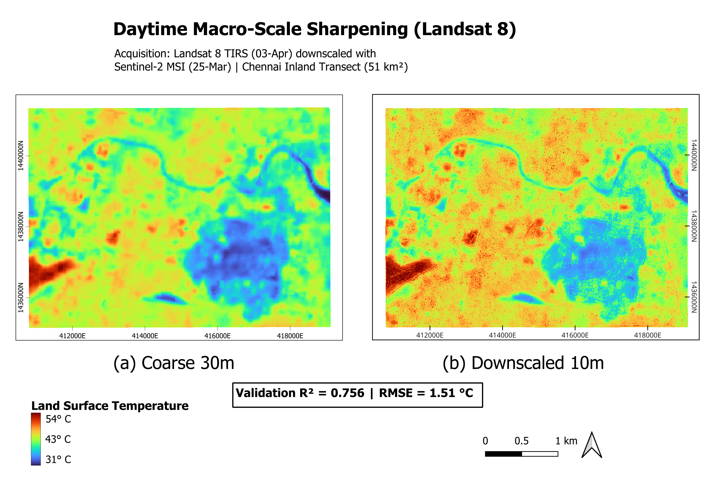
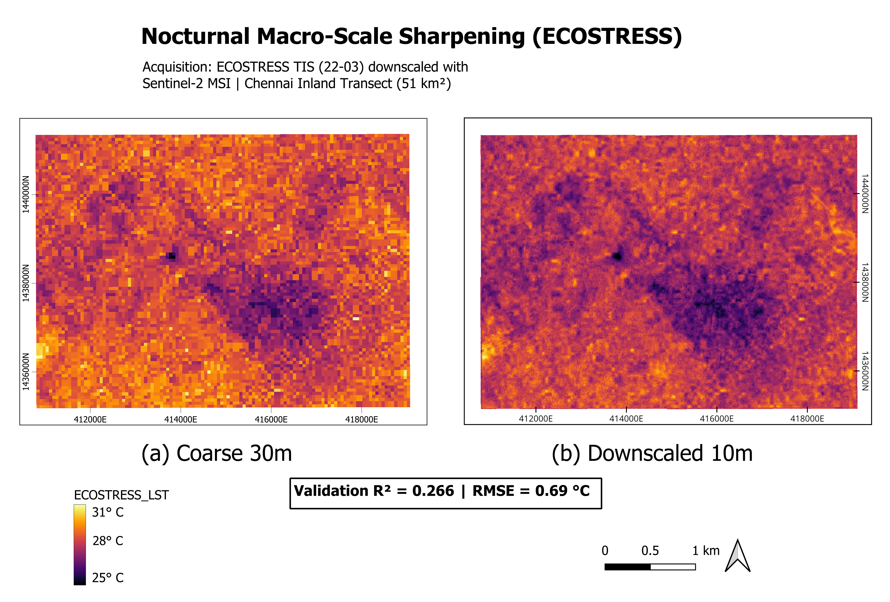
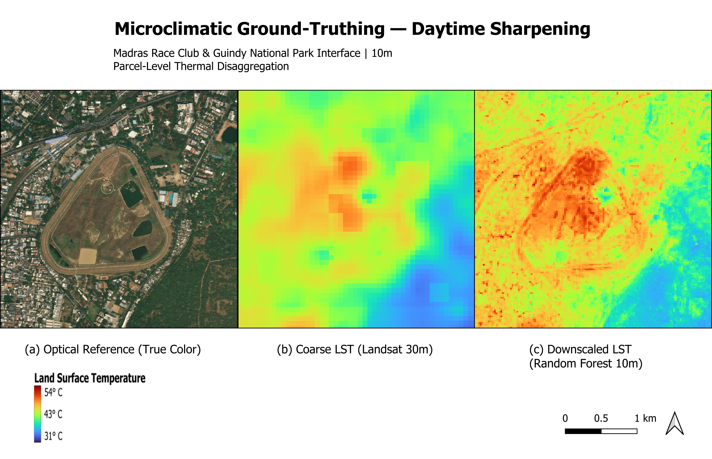
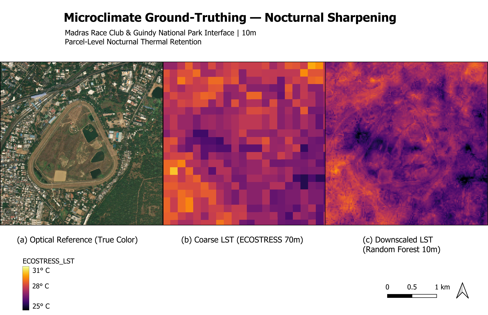
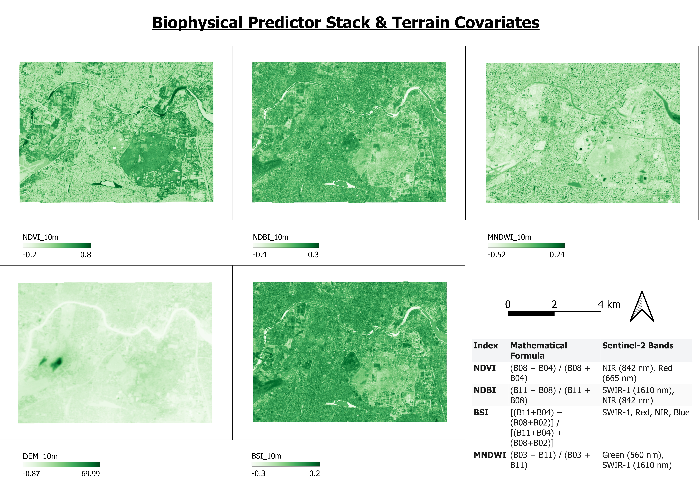

# Multi-Sensor Urban Land Surface Temperature (LST) Downscaling (10m)


-4c1)


An end-to-end remote sensing and machine learning pipeline to downscale daytime Landsat 8 TIRS (30 m) and nocturnal ECOSTRESS (70 m) thermal infrared imagery to **10 m spatial resolution** using Sentinel-2 MSI biophysical covariates and Random Forest regression.

---

## Executive Summary

Satellite-derived Land Surface Temperature (LST) is historically constrained by a fundamental trade-off between spatial and temporal resolution: thermal infrared sensors operate at coarse spatial resolutions (30 m to 1 km), limiting their operational utility for parcel-level urban microclimate planning.

This project implements an **Area-To-Point Random Forest regression framework** with **energy-conserving residual correction** to disaggregate coarse thermal observations across a **51 km² inland transect in Chennai, India**. By modeling non-linear empirical relationships between high-resolution multispectral reflectance, derived spectral indices, terrain covariates, and coarse thermal targets, the pipeline downscales daytime and nocturnal LST to Sentinel-2's 10 m pixel grid.

### Key Performance Findings
* **Daytime (Landsat 8 TIRS):** Achieved an **R² = 0.756** and **RMSE = 1.51 °C**, effectively resolving intra-urban thermal gradients and parcel boundaries.
* **Nocturnal (ECOSTRESS TIS):** Reached a structural limit of **R² = 0.266** and **RMSE = 0.69 °C**, empirically confirming that passive daytime optical reflectance cannot adequately capture nocturnal thermal inertia and heat capacity without structural or radar-derived proxies.

---

## Study Domain & Environmental Setting

The study area covers an inland transect of **51 km²** centered over south-central Chennai, Tamil Nadu, India, projected in **WGS 84 / UTM Zone 44N (EPSG:32644)**.

```text
Coordinate Bounds (UTM Zone 44N):
  Easting  : 411,000 m E  to  419,000 m E
  Northing : 1,435,000 m N to 1,441,000 m N
```
---

## Sensor Specifications & Data Inventory

All spatial layers were preprocessed, clipped to the 51 km² transect, and registered to a uniform UTM Zone 44N spatial reference grid.

| Dataset / Sensor | Platform | Spatial Resolution | Acquisition Date | Spectral Bands / Attributes | Primary Source / Engine |
| :--- | :--- | :--- | :--- | :--- | :--- |
| **Sentinel-2 MSI** | Sentinel-2B | 10 m (B2, B3, B4, B8)<br>20 m (B11, B12) | 25-March-2024 | Bands 2, 3, 4, 8, 11, 12 | ESA Copernicus / GEE |
| **Landsat 8 TIRS** | Landsat 8 | 30 m (Native 100 m resampled) | 03-April-2024 | Band 10 (Split Window LST °C) | USGS / Earth Engine |
| **ECOSTRESS TIS** | ISS | 70 m (Native 70 m) | 08-April-2024 | Nocturnal LST (°C) | NASA LP DAAC / GEE |
| **SRTM DEM** | Shuttle Radar | 30 m | Static Topography | Elevation, Slope, Aspect | NASA / USGS |

---

## Methodology & Algorithmic Workflow
```text
[10m Sentinel-2 Bands & SRTM DEM]
                 │
                 ├──> Calculate Indices: NDVI, NDBI, BSI, MNDWI, Slope, Aspect
                 │
                 ▼
        [10m Predictor Stack (13 Features)]
                 │
                 ├──> Average Resampling (to 30m / 70m Grid)
                 │
                 ▼
        [Coarse Aggregated Predictor Stack]
                 │
                 ├──> Train Random Forest Regressor (Target: Coarse LST)
                 │    (n_estimators=100, max_depth=26, min_samples_split=4)
                 │
                 ▼
        [10m Model Inference] ──> Baseline Downscaled LST (10m)
                 │
                 ├──> Downscale Residuals (Coarse Target - Resampled Baseline)
                 │    (Interpolated via Cubic Spline to 10m)
                 │
                 ▼
     [Corrected Downscaled LST (10m)] (Energy-Conserving Final Output)
```

---

### 1. Biophysical Index Formulations
The 13-feature input space combines visible, near-infrared, shortwave-infrared bands, derived biophysical indices, and terrain parameters:

| Index | Full Name | Sentinel-2 Formulation | Biophysical Role |
| :--- | :--- | :--- | :--- |
| **NDVI** | Normalized Difference Vegetation Index | $\frac{B8 - B4}{B8 + B4}$ | Canopy density, latent heat flux, vegetative cooling |
| **NDBI** | Normalized Difference Built-Up Index | $\frac{B11 - B8}{B11 + B8}$ | Impervious concrete/asphalt surface differentiation |
| **BSI** | Bare Soil Index | $\frac{(B11 + B4) - (B8 + B2)}{(B11 + B4) + (B8 + B2)}$ | Exposed dry soil and unpaved parcel detection |
| **MNDWI** | Modified Normalized Difference Water Index | $\frac{B3 - B11}{B3 + B11}$ | Open water extraction and surface moisture content |

### 2. Random Forest Regressor Architecture
* **Target Aggregation:** 10 m predictors are averaged across coarse thermal pixels ($30\times30\text{ m}$ for Landsat, $70\times70\text{ m}$ for ECOSTRESS) to match scale physics without artificial interpolation.
* **Hyperparameters:** `n_estimators=100`, `max_depth=26`, `min_samples_split=4`, `min_samples_leaf=2`, `n_jobs=-1`.
* **Out-of-Sample Validation:** 80/20 train/test random split on coarse cells.

### 3. Energy-Conserving Residual Correction
Downscaling models inevitably introduce local bias. To ensure thermal energy conservation, coarse-scale residuals are extracted and distributed back to the 10 m baseline:

* **Residual_coarse =** LST_observed_coarse - Mean(LST_predicted_coarse)

* **LST_final_10m =** LST_predicted_10m + Cubic_Interpolation(Residual_coarse)

---

## Empirical Results & Visual Analysis

### Model Performance Metrics

| Target Sensor | Acquisition Time | Resolution Step | Valid Training Pixels ($N$) | Validation RMSE | Validation $R^2$ |
| :--- | :--- | :--- | :--- | :--- | :--- |
| **Landsat 8 TIRS** | Daytime (~10:30 AM) | $30\text{ m} \rightarrow 10\text{ m}$ | 56,918 | **1.51 °C** | **0.756** |
| **ECOSTRESS TIS** | Nocturnal (~10:45 PM) | $70\text{ m} \rightarrow 10\text{ m}$ | 10,366 | **0.69 °C** | **0.266** |

---

### Figure 1: Daytime Macro-Scale Sharpening (Landsat 8)

* **Finding:** The 10 m product resolves intra-urban temperature variations across Guindy National Park and major arterial corridors while strictly preserving the regional $31^\circ\text{C}$ to $54^\circ\text{C}$ thermal distribution. Coarse pixelation along the Adyar river is completely removed.

---

### Figure 2: Nocturnal Macro-Scale Sharpening (ECOSTRESS)

* **Finding:** Nocturnal surface temperatures display a narrow dynamic range ($25^\circ\text{C}$ to $31^\circ\text{C}$). The model captures the general cool boundary of the national park, but exhibits block smoothing due to the coarse 70 m residual grid and lower model explained variance.

---

### Figure 3: Microclimate Ground-Truthing — Daytime (Madras Race Club)

* **Finding:** High-resolution validation over the Madras Race Club (MRC) and adjacent Guindy reserve. The 10 m downscaling isolates the racetrack geometry: the exposed, dry bare soil of the infield spikes to $>50^\circ\text{C}$, sharply contrasting with the vegetated canopy ($<35^\circ\text{C}$) immediately across the boundary. The raw 30 m Landsat image smudges these boundaries into an indistinct heat blur.

---

### Figure 4: Microclimate Ground-Truthing — Nocturnal (Madras Race Club)

* **Finding:** Bare soil that heats up to $>50^\circ\text{C}$ during the daytime rapidly sheds heat at night due to low volumetric thermal capacity, cooling to near-park baseline levels ($~26^\circ\text{C}$). The adjacent dense concrete structures retain daytime heat, showing up as elevated nocturnal thermal signatures.

---

### Figure 5: Biophysical Predictor Stack & Terrain Covariates

* **Finding:** Spatial distribution of high-resolution Sentinel-2 derivatives (NDVI, NDBI, BSI, MNDWI) and SRTM elevation across the 51 km² transect used as training inputs for the Random Forest pipeline.

---

## Predictor Importance Analysis

Relative feature contributions extracted from the Random Forest models:

| Rank | Predictor Layer | Description / Band | Daytime Landsat Weight (%) | Nocturnal ECOSTRESS Weight (%) |
| :---: | :--- | :--- | :---: | :---: |
| **1** | `B12_10m` | SWIR-2 Reflectance (2190 nm) | **22.1%** | 7.7% |
| **2** | `NDBI_10m` | Normalized Difference Built-Up Index | **15.3%** | 6.6% |
| **3** | `BSI_10m` | Bare Soil Index | **12.9%** | 6.5% |
| **4** | `NDVI_10m` | Normalized Difference Vegetation Index | **9.4%** | **10.6%** |
| **5** | `B02_10m` | Blue Reflectance (490 nm) | 7.9% | 9.8% |
| **6** | `B04_10m` | Red Reflectance (665 nm) | 5.7% | 7.3% |
| **7** | `B11_10m` | SWIR-1 Reflectance (1610 nm) | 5.6% | 6.7% |
| **8** | `B03_10m` | Green Reflectance (560 nm) | 4.2% | 7.2% |
| **9** | `Slope_10m` | Terrain Slope | 4.2% | 7.2% |
| **10** | `DEM_10m` | Surface Elevation (SRTM) | 3.6% | 8.7% |
| **11** | `MNDWI_10m` | Modified Water Index | 3.6% | 9.1% |
| **12** | `B08_10m` | NIR Reflectance (842 nm) | 3.4% | 6.5% |
| **13** | `Aspect_10m` | Terrain Aspect | 2.1% | 6.1% |

### Physical Interpretations
* **Daytime Mechanism:** The top four predictors (**B12, NDBI, BSI, NDVI**) account for **59.7% of total feature importance**. The daytime model operates directly on physical surface energy exchange: SWIR absorption and impervious/bare soil coverage dictate sensible heat, while green canopy regulates latent cooling.
* **Nocturnal Disconnect:** Feature weights for ECOSTRESS are flat and evenly distributed across all 13 predictors (each hovering between 6% and 10%). The trees find no distinct physical linkage because optical top-of-canopy reflectance at 10:30 AM cannot capture nocturnal longwave radiation release.

---

## Addressing the Nocturnal Bottleneck

The structural plateau of ECOSTRESS downscaling ($R^2 = 0.266$) highlights a well-documented physical limitation in urban climatology: **at night, thermal emission is controlled by volumetric heat capacity and thermal inertia, not optical albedo**.

### Roadmap for Operational Nocturnal Improvement
1. **Sentinel-1 SAR C-Band Backscatter (10 m):** Incorporating dual-polarized (VV and VH) SAR backscatter captures building geometry, vertical wall density, and 3D urban structural mass through double-bounce microwave scattering, directly proxying nocturnal heat retention.
2. **Apparent Thermal Inertia (ATI):** Deriving multi-temporal thermal resistance ($\text{ATI} = \frac{1 - \text{Albedo}}{\Delta \text{LST}}$) from diurnal temperature swings ($\text{LST}_{\text{day}} - \text{LST}_{\text{night}}$) to supply the model with physical cooling rates.
3. **Building Morphology & Sky View Factor (SVF):** Integrating building footprint density and height data (e.g., OpenStreetMap or Global Building footprints) to account for nocturnal radiation trapping within street canyons.

---

## Repository Structure

```text
Downscaling-Urban-LST-RandomForest/
├── README.md                          <-- Technical Project Report
├── requirements.txt                    <-- Python Package Dependencies
├── LICENSE                            <-- MIT License
├── src/
│   └── downscale_lst_pipeline.py      <-- Modular Pipeline Script
└── figures/                           <-- Cartographic Figures (300 DPI)
    ├── Fig1_Daytime_Macro_Landsat.png
    ├── Fig2_Nighttime_Macro_ECOSTRESS.png
    ├── Fig3_Daytime_Micro_MRC.png
    ├── Fig4_Nighttime_Micro_MRC.png
    └── Fig5_Biophysical_Predictors.png
```

---

## Installation & Execution

### 1. Environment Setup

Clone the repository and install the required dependencies:

```bash
git clone [https://github.com/jeevanmp99/Downscaling-Urban-LST-RandomForest.git](https://github.com/jeevanmp99/Downscaling-Urban-LST-RandomForest.git)
cd Downscaling-Urban-LST-RandomForest
pip install -r requirements.txt
```

### 2. Running the Downscaling Pipeline

Execute the pipeline via terminal for either sensor target using the CLI flags below:

* Option A: Daytime Landsat 8 TIRS Downscaling (30m → 10m)

```Bash
python src/downscale_lst_pipeline.py \
    --data_dir ./data/50_sqkm \
    --output_dir ./downscaled_output \
    --target LANDSAT
```
* Option B: Nocturnal ECOSTRESS TIS Downscaling (70m → 10m)
```Bash
python src/downscale_lst_pipeline.py \
    --data_dir ./data/50_sqkm \
    --output_dir ./downscaled_output \
    --target ECOSTRESS
```

---

## Citation & References

1. **Colaninno, N. (2026).** Multi-Sensor Random Forest Downscaling for 10 m LST Mapping and Urban Heat Island Monitoring in a Small-Sized City. *The International Archives of the Photogrammetry, Remote Sensing and Spatial Information Sciences*, XLIX-B3-2026, 355–362. https://doi.org/10.5194/isprs-archives-XLIX-B3-2026-355-2026
2. **Park, N.-W., Kim, Y., & Kwak, G.-H. (2019).** An Overview of Theoretical and Practical Issues in Spatial Downscaling of Coarse Resolution Satellite-derived Products. *Korean Journal of Remote Sensing*, 35(4), 589–607. https://doi.org/10.7780/kjrs.2019.35.4.8
